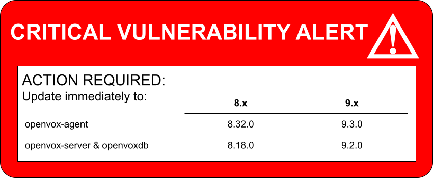

## tl;dr: Upgrade your OpenVox servers immediately.

{: .callout }

It's been quite a month, y'all. Did you know that the information security industry considers [October 2026 to be a watershed moment](https://en.wikipedia.org/wiki/Black_October_(information_security))? From the Linux kernel's TCP stack, to PHP2Shell, to... uh... the number 4, the vulnerability flood just keeps coming.

The OpenVox project is no different. In mid October we received two vulnerability alerts from a researcher at [Neodyme](https://neodyme.io). Both were evaluated and scored at critical. Shortly after, we received another alert to the `container-openvoxdb` project, also scored at critical.

## The vulnerabilities

### Remote Code Execution on the OpenVox Server

The Puppet/OpenVox report is a JSON document the agent sends to the server after each enforcement run. It details what changes were made, any warnings or error messages, and any resources that failed to apply correctly. It also contains a full list of all _events_ that happened, where an event might be "content \<foo\> changed to \<bar\>" or the like. In some circumstances involving custom resource types, an event might include a serialized Ruby object (programming code turned into text) instead of just plain JSON. When the report is processed, these objects are deserialized back into something the compiler can use. Unfortunately a malicious event object can be constructed in such a way that code executes on the server when this happens. ([read more](https://github.com/OpenVoxProject/openvox/security/advisories/GHSA-ffr6-rwpm-p5wq))

### Client Impersonation in Trapperkeeper apps

Trapperkeeper is the framework we use for running our Clojure based applications and `trapperkeeper-authorization` is the shared authentication library that parses OpenVox's `auth.conf` file and such. This file allows authentication rules to be specified in multiple ways, including plain strings (`foo.example.com`), wildcards (`*.example.com`), or regular expressions (`/lab-\d{3}.example.com/`). Plain strings and wildcard matches were handled by the same logic and this resulted in wildcard behavior incorrectly showing up in all non-regex rules. The end result of this meant that a certificate name of `evil.target.example.com` would be allowed to impersonate `target.example.com` and access information or perform actions as the target certname. In some non-default configurations, this could even inject exported resources into arbitrary agent catalogs across the infrastructure. ([read more](https://github.com/OpenVoxProject/trapperkeeper-authorization/security/advisories/GHSA-q4hm-33rc-572g))

### Container `ALLOWLIST` not respected

The `container-openvoxdb` image programmatically generates its `ALLOWLIST` from the `OPENVOXDB_CERTIFICATE_ALLOWLIST` environment variable on startup. This script failed because a required tool wasn't installed and the result was that any certificate was allowed to access the API. ([read more](https://github.com/OpenVoxProject/container-openvoxdb/security/advisories/GHSA-c4wc-g5pp-7wfp))

## Responsible disclosure

You may have noticed that the container was updated the same day we received the vulnerability alert, while the other two were delayed by a few weeks. In reality, all three issues were fixed within 1-3 days but coordinating with other companies and downstream distributions takes some time. November 3rd was the most reasonable coordinated release date that allowed Puppet Enterprise to also be fixed and published.

As we're still a young project and developing some of our protocols, it was good to have our efforts acknowledged.
> Thank you all for the expectionally good and fast disclosure process! As you can imagine, reporting security vulnerabilities to projects is often a cumbersome task and we've rarely seen such a good handling of the disclosure.
> - [`alain-neodyme`](https://github.com/alain-neodyme)

## Updating or migrating

All known Puppet implementations are vulnerable to the CVEs fixed in today's releases. Whether your Puppet implementation comes from us, from Puppet Enterprise, or from a distribution package, you should update today.

Please note that if you have not yet migrated from Open Source Puppet to OpenVox, now would be a good time for that, since **Puppet will not be receiving any more updates**, security or not.
See our migration guides for [Puppet 7 to OpenVox 8](https://docs.openvoxproject.org/openvox/8.x/upgrade_major.html) and [OpenVox 8 to OpenVox 9](https://docs.openvoxproject.org/openvox/9.x/upgrade_major.html).
{: .alert .alert-warning }

If you are already running OpenVox, then your system package manager can upgrade to the following versions or greater. If you need to migrate, then [follow instructions](https://voxpupuli.org/openvox/install/).

|                  |  8.x   |  9.x  |
|------------------|--------|-------|
| `openvox-agent`  | 8.32.0 | 9.3.0 |
| `openvox-server` | 8.18.0 | 9.2.0 |
| `openvoxdb`      | 8.18.0 | 9.2.0 |
{: .table }

If you're using the OpenVoxDB container, then you should ensure that the tag you are pulling is `8.18.0` or greater, or `latest`.

If you've added custom authentication rules, e.g. in `auth.conf`, then validate them post upgrade to ensure that they're still working as you intended. Custom rules may have depended on buggy behaviour and may need to be updated.

## Mitigations

If you are unable to upgrade at this time, then there are some mitigation steps you can take to reduce your risk.

* Both of the OpenVox Server vulnerabilities require having network access and a valid signed certificate. To reduce that exposure, you should
    * ensure that the server is only reachable from the network segments which require access.
    * disable or tighten access to autosign. Consider using the [autosign tool](https://github.com/voxpupuli/autosign).
    * In serverless infrastructures, disable OpenVoxDB access for individual nodes.
* If you are comfortable with system level surgery, both patches are available as standalone files that might or might not apply cleanly on old and outdated versions of Puppet or OpenVox. Here are auto-patching scripts that will verify requirements before applying each embedded patch:
    * [RCE on OpenVox Server via event deserialization](https://github.com/overlookinfra/openvox-security-patches/blob/main/scripts/GHSA-ffr6-rwpm-p5wq-Authenticated-RCE-on-Puppet-server-via-Event-Deserialization.sh)
    * [Flawed hostname check allows client impersonation](https://github.com/overlookinfra/openvox-security-patches/blob/main/scripts/GHSA-q4hm-33rc-572g-Flawed-Hostname-Check-allows-Puppet-Client-Impersonation.sh)

Please note that these mitigations do not necessarily eliminate your risk. Only use them if you understand what they may or may not protect you from. You assume all responsibility when manually patching your systems.

## Thanks and Credits

* Thanks to Alain from [Neodyme](https://neodyme.io/) for reporting the server issues and working with us to coordinate. [Read their writeup here](https://neodyme.io/en/blog/puppet_rce/) when it goes live, it's a wild ride!
* Thanks to Puppet by Perforce Security and Engineering teams for coordinating with us and accelerating their release schedule.
* Thanks to Samuel Soulard and Justin Lussier from genetech.com for reporting the container issue.
* Thanks to Lance and the [OSU Open Source Lab](https://osuosl.org/), who spent the last week updating certificate stores, kernels, and PHP and still giving us stable and secure hosting.
* Thanks for all the hard work from everyone who helped with this effort. The committers on each of the specific code fixes are just the tip of the iceberg. There are people who reviewed the reports, validated fixes, provided expertise, helped coordinate, helped wordsmith things, engaged with adjacent communities, helped with tooling, and project managing, and so much more. There's not enough space here to name all the contributors, but thank you.
* Thanks for their employers who granted the time to make it happen. [Overlook InfraTech](https://overlookinfratech.com/), [Betadots](https://www.betadots.de/), [LTN Global](https://ltnglobal.com), [Red Hat](https://redhat.com), [Sicura](https://sicura.us), [Fenix One](https://www.fenix-one.com), [University of Toronto](https://www.utoronto.ca), and others.
* A very special thanks to [Kenyon Ralph](https://github.com/kenyon) from Qualcomm who continued reviewing code and contributing even after being hit by a car on his bicycle during his regular commute. Watch out for cyclists, y'all!

And thanks to *you*, for being part of this very special community.
